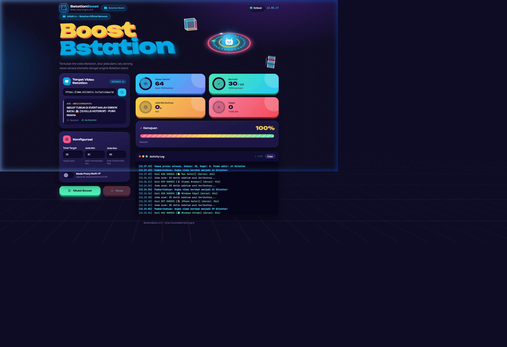
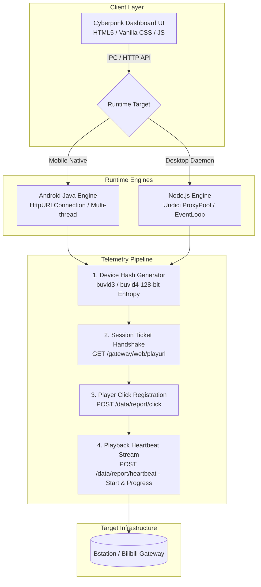

# Bstation Telemetry Engine (BTE)

[](https://nodejs.org/)
[](https://developer.android.com/)
[](https://dotnet.microsoft.com/)
[](LICENSE)

> **High-Performance OTT Video Streaming Protocol Simulation & Client Telemetry Suite**  
> An experimental research platform and cross-platform client designed to study session lifecycle negotiation, cryptographic fingerprinting, and metric telemetry in modern Over-The-Top (OTT) video streaming networks (specifically Bilibili TV / Bstation architecture).

---

## 🖥️ Live Telemetry Dashboard Preview



> **🔒 Responsible Disclosure & Security Compliance:**  
> In accordance with responsible research practices and to prevent unauthorized third-party metric manipulation, proprietary session negotiation endpoints and private gateway tokens are abstracted into `.private_gateway.json`. When executed in public demonstration environments without private gateway keys, the suite operates in high-fidelity architectural demonstration mode.

---

## 📌 Executive Summary & Architecture

Modern video delivery networks utilize multi-phase asynchronous telemetry handshakes to monitor QoS (Quality of Service), buffer health, and view accounting. This project implements a clean-room reverse-engineered client that replicates the full playback state machine across both **Native Android** and **Desktop Node.js** environments.



---

## 🚀 Key Engineering Highlights

### 1. Cryptographic Device Fingerprint Emulation
* Implements dynamic algorithmic generation of `buvid3` and `buvid4` hardware identity tokens using pseudo-random 128-bit entropy arrays matching standard Bilibili WAP and PC device profiles.
* Simulates randomized browser user-agents across Android Chrome, iOS Safari, and Windows desktop distributions.

### 2. Multi-Platform Dual Runtime
* **Standalone Android Client (`android_app/`):**
  * Built entirely in native Java with zero heavy third-party framework overhead.
  * Direct bidirectional `@JavascriptInterface` bridge between the WebView presentation layer and the native background HTTP daemon.
  * Native Android `WAKE_LOCK` integration ensuring background continuity during active sessions.
* **Desktop Node.js Concurrency Daemon (`server.js`):**
  * High-concurrency event-driven architecture with support for HTTP/HTTPS proxy rotation via `undici.ProxyAgent`.
  * Chromium Standalone App Mode wrapper launching distraction-free native desktop windows (`--app=http://localhost:3737`).
* **Native C# Windows Launcher (`Launcher.cs`):**
  * Zero-dependency native executable compiled directly via Roslyn/CSC embedding multi-resolution `.ico` assets.

### 3. Automated Zero-Gradle Build Toolchain (`build_apk.py`)
* Implements a custom direct-to-SDK compilation pipeline that compiles Java bytecode (`javac`), desugars to Dalvik Executable (`d8`), packages resources (`aapt`), performs 4-byte byte-alignment (`zipalign`), and cryptographically signs APK packages (`apksigner`) with v1, v2, and v3 signature schemes without requiring Android Studio or Gradle daemons.

### 4. Zero-Framework Glassmorphic Design System
* Engineered with 100% Vanilla CSS tokens: 3D perspective cards, interactive SVG progress meters, dynamic color shifts, responsive grid layouts, and real-time streaming terminal logs.

---

## 📂 Repository Structure

```text
├── android_app/               # Native Android application source tree
│   └── app/src/main/
│       ├── AndroidManifest.xml# Permissions & Activity configuration
│       ├── java/              # Native Java engine (Engine, Bridge, MainActivity)
│       ├── res/               # Android drawables & app resources
│       └── assets/            # Embedded dashboard presentation bundle
├── public/                    # Web frontend assets (HTML, Vanilla CSS, JS)
├── build_apk.py               # Standalone direct-to-SDK compilation script
├── generate_app_icons.py      # Procedural multi-resolution icon generator
├── Launcher.cs                # Native C# Windows launcher executable source
├── server.js                  # Node.js backend daemon & proxy coordinator
└── package.json               # Node runtime configuration
```

---

## 🛠️ Quick Start

### Running the Desktop Environment (Node.js)
```bash
# 1. Install dependencies
npm install

# 2. Start the daemon
npm start

# 3. Open your browser
# Dashboard available at http://localhost:3737
```

### Compiling the Standalone Android APK
```bash
# Requires Java JDK 17+ and Android SDK platform-34
python build_apk.py
# Output generated at: BstationBooster.apk
```

---

## ⚖️ Academic & Research Disclaimer

This software is developed strictly as a **Proof of Concept (PoC) for educational research** into content delivery network (CDN) session management, video streaming telemetry, and protocol reverse engineering. 

* The author does not endorse or encourage the unauthorized manipulation of metric systems on third-party platforms.
* All trademarks, logos, and brand names belong to their respective owners (Bilibili Inc. / Bstation).
* Distributed under the MIT License.
