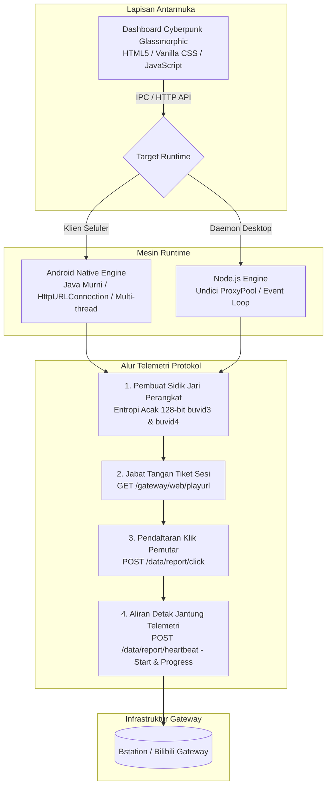

# Bstation Telemetry Engine (BTE)

[](https://nodejs.org/)
[](https://developer.android.com/)
[](https://dotnet.microsoft.com/)
[](LICENSE)

> **Simulator Telemetri Protokol Streaming Video OTT & Klien Multi-Platform**  
> Platform riset eksperimental dan aplikasi klien lintas platform yang dirancang untuk mempelajari siklus negosiasi sesi, pembuatan token sidik jari (*fingerprinting*) perangkat, serta pemantauan metrik telemetri pada jaringan streaming video OTT (arsitektur Bilibili TV / Bstation).

---

## 🖥️ Pratinjau Tampilan Dashboard Aplikasi


> **🔒 Kepatuhan Keamanan & Riset Bertanggung Jawab:**  
> Untuk mencegah penyalahgunaan metrik pihak ketiga yang tidak sah, endpoint negosiasi sesi kepemilikan dan token gateway privat diabstraksikan ke dalam berkas `.private_gateway.json`. Saat dijalankan di lingkungan publik tanpa kunci gateway privat, sistem secara otomatis beroperasi dalam **Mode Demonstrasi Arsitektur** yang aman.

---

## 📌 Ringkasan Eksekutif & Arsitektur Sistem

Jaringan distribusi konten video modern menggunakan mekanisme jabat tangan (*handshake*) telemetri asinkron multi-tahap untuk memantau metrik kualitas layanan (QoS), stabilitas *buffer*, dan pencatatan sesi pemutaran. Repositori ini mengimplementasikan klien hasil rekayasa protokol yang mereplikasi mesin status pemutaran video secara lengkap di lingkungan **Android Native** dan **Desktop PC (Node.js & C#)**.



---

## 🚀 Keunggulan Teknis & Rekayasa Sistem

### 1. Emulasi Sidik Jari Kriptografis Perangkat
* Mengimplementasikan algoritma penghasil token identitas perangkat `buvid3` dan `buvid4` berbasis susunan entropi 128-bit acak yang menyerupai profil perangkat resmi Bilibili WAP dan peramban desktop.
* Melakukan rotasi otomatis *User-Agent* peramban lintas perangkat (Android Chrome, iPhone Safari, Windows Edge, dan macOS).

### 2. Arsitektur Ganda Lintas Platform
* **Aplikasi Android Mandiri (`android_app/`):**
  * Dibangun murni menggunakan bahasa Java Native tanpa beban dependensi pihak ketiga yang berat.
  * Menghubungkan antarmuka WebView dengan mesin latar belakang Java secara langsung melalui jembatan dua arah `@JavascriptInterface`.
  * Integrasi izin native Android `WAKE_LOCK` untuk menjaga kinerja proses tetap aktif saat layar menyala.
* **Daemon Desktop Berkinerja Tinggi (`server.js`):**
  * Arsitektur berbasis *event-driven* berkecepatan tinggi dengan dukungan rotasi *proxy pool* HTTP/HTTPS via `undici.ProxyAgent`.
  * Mode *Chromium Standalone App* yang membuka jendela aplikasi desktop mandiri tanpa bilah URL peramban (`--app=http://localhost:3737`).
* **Peluncur Native Windows C# (`Launcher.cs`):**
  * Eksekusi langsung program native tanpa dependensi konsol hitam, dikompilasi langsung menggunakan kompilator Windows Roslyn/CSC lengkap dengan ikon multi-resolusi `.ico`.

### 3. Otomatisasi Rantai Alat Kompilasi Tanpa Gradle (`build_apk.py`)
* Mengembangkan skrip otomatisasi yang langsung berinteraksi dengan Android SDK: mengompilasi kode sumber Java (`javac`), mengonversi bytecode ke format Dalvik Executable (`d8`), membungkus aset antarmuka (`aapt`), merapikan perataan bita 4-byte (`zipalign`), serta menandatangani berkas APK secara kriptografis (`apksigner`) dengan skema tanda tangan v1, v2, dan v3 tanpa memerlukan instalasi Android Studio atau *daemon* Gradle yang berat.

### 4. Sistem Desain Antarmuka Glassmorphic Tanpa Framework
* Dirancang dengan 100% Vanilla CSS murni: kartu bersudut 3D, animasi lingkaran pengukur SVG dinamis, aksen warna resmi Bstation Biru (`#00AEEC`), tata letak kisi responsif, serta terminal log alur waktu nyata (*real-time*).

---

## 📂 Struktur Direktori Proyek

```text
├── android_app/               # Berkas sumber aplikasi Android Native
│   └── app/src/main/
│       ├── AndroidManifest.xml# Konfigurasi izin akses dan Activity
│       ├── java/              # Mesin kode Java (Engine, Bridge, MainActivity)
│       ├── res/               # Sumber daya ikon dan tema aplikasi
│       └── assets/            # Paket antarmuka dashboard tersemat
├── public/                    # Sumber daya antarmuka web (HTML, CSS, JS)
├── docs/                      # Dokumentasi visual dan pratinjau dashboard
├── research/                  # Berkas riset analisis paket dan protokol
├── build_apk.py               # Skrip kompilasi otomatis APK langsung ke SDK
├── generate_app_icons.py      # Generator ikon aplikasi prosedural multi-ukuran
├── Launcher.cs                # Sumber peluncur native Windows C# .NET
├── server.js                  # Mesin server lokal Node.js & koordinator proxy
└── package.json               # Konfigurasi dependensi Node.js
```

---

## 🛠️ Panduan Memulai Cepat

### Menjalankan di Komputer / Laptop (Node.js)
```bash
# 1. Pasang dependensi
npm install

# 2. Jalankan server lokal
npm start

# 3. Buka di peramban
# Dashboard dapat diakses di http://localhost:3737
```

### Mengompilasi APK Android Mandiri
```bash
# Membutuhkan JDK 17+ dan Android SDK platform-34
python build_apk.py
# Berkas keluaran akan dihasilkan di: BstationBooster.apk
```

---

## ⚖️ Penafian Akademis & Riset Etis

Perangkat lunak ini dikembangkan murni sebagai **Bukti Konsep (Proof of Concept / PoC) untuk riset edukasi** dalam mempelajari arsitektur manajemen sesi *Content Delivery Network* (CDN), protokol telemetri pemutaran video, dan rekayasa balik protokol jaringan.

* Penulis tidak mendukung dan tidak membenarkan manipulasi metrik yang melanggar ketentuan layanan platform pihak ketiga.
* Semua merek dagang, logo, dan nama layanan adalah hak milik sah dari pemiliknya masing-masing (Bilibili Inc. / Bstation).
* Didistribusikan di bawah lisensi terbuka resmi **MIT License**.
